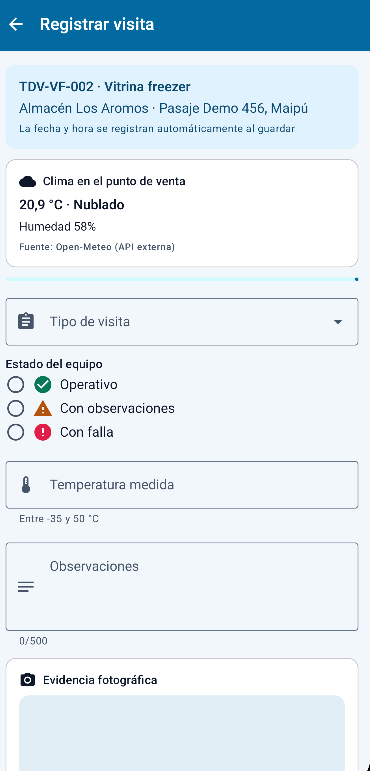
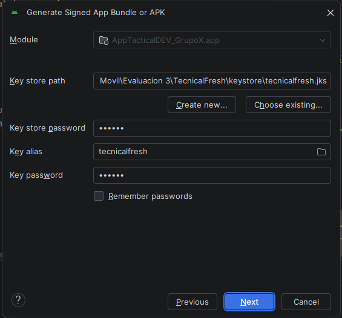
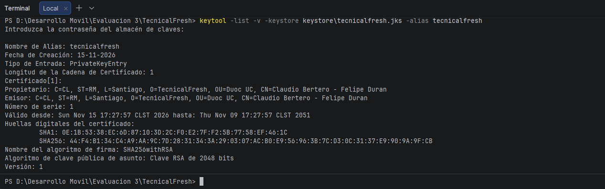
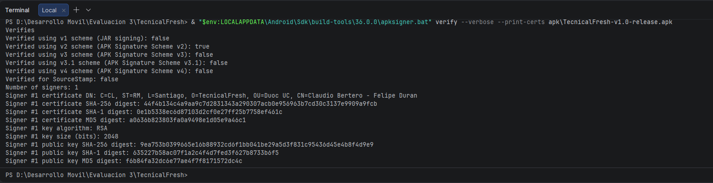

# Technical Fresh · Trazabilidad y Verificación de Visitas en Terreno

Proyecto semestral de **DSY1105 Desarrollo de Aplicaciones Móviles** (Duoc UC · Evaluación Parcial 3).

Aplicación móvil Android nativa que resuelve el problema de trazabilidad en la mantención y revisión de equipos de refrigeración (vitrinas freezer y conservadoras) en puntos de venta. Reemplaza el uso informal de WhatsApp, Excel y papel, evitando las *"visitas fantasma"* mediante verificación física con sensores nativos (GPS, cámara y escáner QR), y centraliza la supervisión en un microservicio propio en la nube.

---

## 👥 Equipo de Desarrollo

| Integrante | Rol en el Proyecto |
| :--- | :--- |
| **Claudio Bertero** | Arquitectura, modelos y repositorios de la app, integración con el microservicio (usuarios, visitas), seguridad, pruebas unitarias y APK firmado |
| **Felipe Durán** | UI/UX con Jetpack Compose, navegación y dashboards; microservicio Spring Boot (técnicos, usuarios, puntos de venta, activos) y despliegue |

---

## 🚀 Funcionalidades

### 1. Autenticación y registro
- **Login y registro contra el microservicio:** las cuentas se guardan en MySQL, por lo que un usuario puede ingresar desde cualquier teléfono.
- **Seguridad de claves:** la app envía la clave por HTTPS y el servidor la almacena con **BCrypt**; el hash nunca se devuelve en las respuestas de la API.
- **Sesión persistente** con Jetpack DataStore Preferences.

### 2. Paneles por rol
- **Operario** (Técnico, Vendedor, Transportista): vitrinas asignadas, mis visitas, escáner QR y perfil.
- **Supervisor:** validación de visitas, administración de locales y activos, y asignación de locales al equipo.

### 3. Verificación en terreno
- **Escáner QR** (Google ML Kit) para abrir directamente la ficha de cada vitrina.
- **GPS:** calcula la distancia al local y marca la visita como verificada si está a menos de 150 m.
- **Evidencia fotográfica** obligatoria, enviada al servidor comprimida en Base64.
- **Control de cadena de frío:** alerta visual ante temperaturas críticas.
- **Clima del punto de venta (API externa):** temperatura, condición y humedad actuales del local, con aviso en días calurosos.

### 4. Supervisión y trazabilidad
- Las visitas se guardan en **MySQL**: lo que registra el técnico lo ve el supervisor desde su propio teléfono.
- Bandeja de revisión por estado (pendientes, validadas, rechazadas), con **validación o rechazo con motivo obligatorio**.
- Historial por operario y por vitrina.

### 5. Administración
- Alta de puntos de venta (con la ubicación GPS actual) y de activos frigoríficos.
- Asignación de locales a cada trabajador, con **modo sin conexión**: si no hay internet la asignación queda pendiente y se sincroniza sola al reconectar.

### 6. Experiencia de usuario
- Diseño adaptativo (Window Size Classes), modo oscuro y animaciones con Jetpack Compose.

---

## 🛠️ Tecnologías

- **App:** Kotlin, Jetpack Compose + Material 3, MVVM con StateFlow, Retrofit 2 + Gson + Coroutines, DataStore, Room (caché local), Play Services Location, ML Kit Barcode, Coil.
- **Microservicio:** Spring Boot, Spring Data JPA, MySQL, BCrypt (`spring-security-crypto`), desplegado en **Railway**.
- **API externa:** [Open-Meteo](https://open-meteo.com) (clima, sin clave de acceso).
- **Pruebas:** Kotest + MockK + kotlinx-coroutines-test, cobertura con JaCoCo.
- **Planificación y versiones:** Git y GitHub con GitFlow (`main`, `develop`, ramas `feature/T-xx`) y Trello.

---

## 🌐 Arquitectura y Endpoints

```
                    ┌──HTTPS──▶ Microservicio Spring Boot (Railway) ──▶ MySQL (Railway)
App Android ────────┤
 (Retrofit)         └──HTTPS──▶ API externa Open-Meteo (clima)
```

La app usa **dos clientes Retrofit independientes** (`RetrofitInstance` y `OpenMeteoInstance`), de modo que la API externa no interfiere con el microservicio propio.

### Microservicio propio

- **Repositorio:** [Fduran32/microservicoTecnicalFresh](https://github.com/Fduran32/microservicoTecnicalFresh)
- **URL base:** `https://microservicotecnicalfresh-production-c2a9.up.railway.app/`

| Método | Endpoint | Descripción |
| :--- | :--- | :--- |
| `POST` | `/api/v1/usuarios/registro` | Registra un usuario (clave guardada con BCrypt). `201` creado · `409` correo repetido |
| `POST` | `/api/v1/usuarios/login` | Inicia sesión. `200` con el usuario · `401` credenciales incorrectas |
| `GET` | `/api/v1/usuarios?rol=OPERARIO` | Lista usuarios (sin claves), opcionalmente por rol |
| `GET` | `/api/v1/puntos-venta` | Lista los puntos de venta |
| `POST` | `/api/v1/puntos-venta` | Crea un punto de venta |
| `GET` | `/api/v1/activos` | Lista los activos (vitrinas y conservadoras) |
| `GET` | `/api/v1/activos/{id}` | Obtiene un activo |
| `GET` | `/api/v1/activos/codigo/{codigo}` | Busca un activo por su código QR |
| `POST` | `/api/v1/activos` | Crea un activo |
| `POST` | `/api/v1/visitas` | Registra una visita (queda `PENDIENTE`) |
| `GET` | `/api/v1/visitas?usuarioId=&activoId=&estado=` | Lista visitas con filtros opcionales |
| `GET` | `/api/v1/visitas/{id}` | Detalle de una visita |
| `PUT` | `/api/v1/visitas/{id}/validar` | El supervisor valida la visita |
| `PUT` | `/api/v1/visitas/{id}/rechazar` | El supervisor rechaza la visita (motivo obligatorio) |
| `GET` | `/api/v1/tecnicos` | Lista las asignaciones de locales |
| `POST` | `/api/v1/tecnicos` | Asigna un local a un trabajador |
| `DELETE` | `/api/v1/tecnicos/{id}` | Elimina una asignación |

### API externa: Open-Meteo

| Método | Endpoint | Uso en la app |
| :--- | :--- | :--- |
| `GET` | `https://api.open-meteo.com/v1/forecast?latitude={lat}&longitude={lon}&current=temperature_2m,relative_humidity_2m,weather_code&timezone=auto` | Clima actual en la ubicación del punto de venta, mostrado en el formulario de visita |



### Persistencia

| Dato | Dónde se guarda |
| :--- | :--- |
| Usuarios, visitas, puntos de venta, activos y asignaciones | **MySQL en Railway** (microservicio) |
| Sesión del usuario | DataStore en el teléfono |
| Copia local para funcionar sin internet | Room (usuarios, locales, activos) y cola de asignaciones pendientes |

---

## 🔑 Usuarios de Prueba

Todos usan la clave **`Clave123`**.

| Perfil / Cargo | Correo | Función principal |
| :--- | :--- | :--- |
| **Técnico de mantenimiento** | `tecnico@demo.cl` | Mantenciones, lectura QR y temperatura |
| **Vendedor** | `vendedor@demo.cl` | Visitas comerciales y estado de equipos |
| **Transportista** | `transportista@demo.cl` | Entregas, retiros y evidencia en terreno |
| **Supervisor de operaciones** | `supervisor@demo.cl` | Validación de visitas y administración |

---

## 📲 Pasos para Ejecutar

### Opción A: instalar el APK firmado
1. Descarga [`apk/TecnicalFresh-v1.0-release.apk`](apk/TecnicalFresh-v1.0-release.apk) en un teléfono con Android 8.0 o superior.
2. Permite la instalación de apps desconocidas e instálalo.
3. Inicia sesión con un usuario de prueba.

### Opción B: desde el código
1. Clona el repositorio:
   ```bash
   git clone https://github.com/Cbertero/TecnicalFresh.git
   ```
2. Ábrelo en Android Studio y espera la sincronización de Gradle.
3. Ejecuta la app en un emulador o teléfono (API 26+).

> La app ya apunta al microservicio en Railway, no es necesario levantarlo localmente.
> Para probar contra un microservicio local desde el emulador, cambia `BASE_URL` en `RetrofitInstance.kt` a `http://10.0.2.2:8081/`.

### Generar el APK firmado
```bash
./gradlew assembleRelease
```
El APK queda en `app/build/outputs/apk/release/app-release.apk`, firmado con la configuración de `keystore.properties`.

---

## 🔐 APK Firmado y Llave (.jks)

| Archivo | Ubicación |
| :--- | :--- |
| APK release firmado | [`apk/TecnicalFresh-v1.0-release.apk`](apk/TecnicalFresh-v1.0-release.apk) |
| Llave de firma | [`keystore/tecnicalfresh.jks`](keystore/tecnicalfresh.jks) (alias `tecnicalfresh`, RSA 2048, válida hasta 2051) |
| Configuración de firma | `signingConfigs` en [`app/build.gradle.kts`](app/build.gradle.kts), leyendo [`keystore.properties`](keystore.properties) |

**Creación de la llave en Android Studio:**



**Contenido de la llave (`keytool -list -v`):**



**Verificación del APK firmado (`apksigner verify`):**



La huella SHA-256 del certificado (`44:F4:B1:34:...:9F:CB`) es la misma en la llave y en el APK, lo que confirma que el APK fue firmado con esta llave.

> ⚠️ El `.jks` y sus claves se incluyen en el repositorio porque la pauta de evaluación lo solicita. En un proyecto real **nunca** se suben a GitHub: se guardan fuera del repositorio o en un gestor de secretos.

---

## 🧪 Pruebas Unitarias

Escritas con **Kotest** (estilo `FunSpec`) y **MockK**; se ejecutan en la JVM, sin emulador.

| Capa | Qué se prueba | Técnica |
| :--- | :--- | :--- |
| Validadores, modelos, utilidades y navegación | Reglas de negocio y funciones puras | Entrada → salida esperada |
| Repositorios del microservicio (usuarios, activos, visitas, técnicos) | Respuestas correctas, errores HTTP (401, 409, 500) y falta de conexión | `mockkObject(RetrofitInstance)` |
| Repositorio de la API externa (clima) | Conversión de la respuesta, datos incompletos y fallos | Mock de `OpenMeteoApi` |
| ViewModels | Validaciones, mensajes, guardado, errores de red y navegación | Mocks + `Dispatchers.Main` de prueba |

```bash
./gradlew testDebugUnitTest      # ejecutar las pruebas
./gradlew jacocoTestReport       # pruebas + reporte de cobertura
```
El reporte queda en `app/build/reports/jacoco/jacocoTestReport/html/index.html`.

**Resultados actuales:** 202 pruebas, 0 fallos y **99,5% de cobertura de líneas**.

> La cobertura se mide sobre la lógica de la app (ViewModels, repositorios, validaciones, modelos y utilidades). Se excluyen las pantallas Compose y los envoltorios del framework Android (GPS, cámara, DataStore, DAO de Room), que requieren pruebas instrumentadas en un emulador.

---

## 📋 Planificación (Trello)

- **Tablero:** _agregar aquí el enlace al tablero de Trello_
- Las tareas del tablero (`T-xx`) corresponden a las ramas `feature/T-xx-...` del repositorio.
